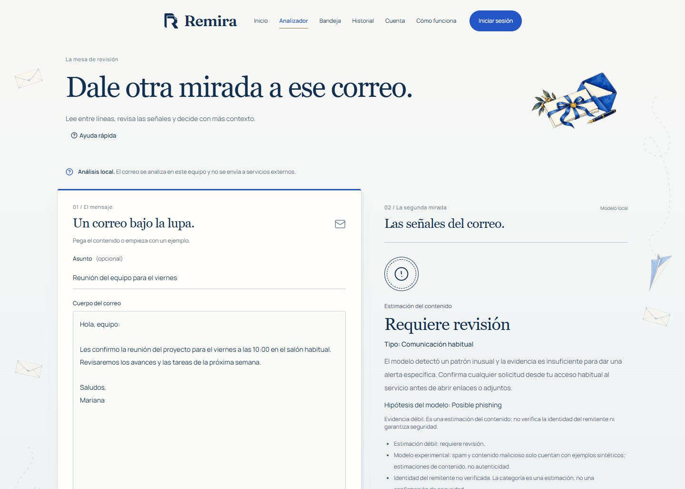
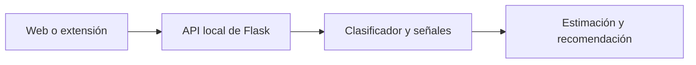

<p align="center">
  
</p>

<h1 align="center">Remira</h1>

<p align="center"><strong>Una segunda mirada a tus mensajes.</strong></p>

<p align="center">Análisis local de correos electrónicos para identificar señales de spam, phishing y contenido potencialmente malicioso.</p>

<p align="center">
  <a href="#qué-es-remira">El proyecto</a> ·
  <a href="#cómo-funciona">Cómo funciona</a> ·
  <a href="#inicio-rápido">Instalación</a> ·
  <a href="#evaluación-experimental">Evaluación</a>
</p>

<p align="center">
  
</p>

## Qué es Remira

Una factura, un aviso de cuenta y un correo fraudulento pueden parecerse a
primera vista. Remira ayuda a decidir qué revisar antes de actuar. Analiza
el asunto y el cuerpo del mensaje, estima si parece legítimo, spam, phishing
o contenido malicioso y muestra las señales disponibles junto con una
recomendación. También puede identificar posibles finalidades, como una factura
o una solicitud de pago.

Es un prototipo académico de **Técnicas de Inteligencia Artificial** que combina
aprendizaje supervisado con reglas para interpretar la evidencia del mensaje.
El análisis ocurre en tu computadora y la API procesa el contenido en memoria.

## Qué puedes hacer

| Interfaz | Qué ofrece |
| --- | --- |
| **Analizador web** | Pega el asunto y el cuerpo en `/analizar` o prueba un ejemplo incluido. Consulta la categoría estimada, la evidencia y la recomendación de revisión. La bandeja, el historial y la cuenta son demostraciones. |
| **Extensión para Chrome y Edge** | Revisa el mensaje que elijas en Gmail, importa un archivo `.eml` o extrae texto de imágenes con OCR local en español e inglés. Puedes corregir el texto extraído antes de enviarlo a análisis. |



*La captura muestra un correo ficticio y el resultado «Requiere revisión» cuando la evidencia es insuficiente.*

## Cómo funciona



1. La web envía el texto que ingresas. La extensión también puede aportar el
   remitente y los enlaces que haya extraído del mensaje.
2. La API Flask, en `127.0.0.1:8765`, normaliza el texto y aplica un modelo
   supervisado con TF-IDF de palabras y caracteres.
3. Remira combina las puntuaciones con las señales disponibles y explica qué
   conviene revisar. Si la evidencia es insuficiente, puede mostrar un
   resultado no concluyente.

Los resultados son orientativos. La estimación de legitimidad por texto deja
pendiente comprobar la identidad del remitente por un canal conocido.

## Inicio rápido

Necesitas Python 3.11 y Node.js 22.18 o una versión posterior compatible con los
proyectos del repositorio. Los comandos siguientes son para PowerShell.

1. Desde la raíz, crea el entorno e instala las dependencias.

   ```powershell
   python -m venv .venv
   .\.venv\Scripts\python.exe -m pip install -r requirements.txt
   ```

2. Prepara el corpus y el modelo según la [guía de instalación](extension/README.md#preparación).
   Después arranca la API desde la raíz.

   ```powershell
   .\.venv\Scripts\python.exe -m src.api
   ```

3. En otra terminal, arranca la web.

   ```powershell
   Set-Location frontend
   npm ci
   npm run dev -- --host 127.0.0.1 --port 5173 --strictPort
   ```

   Abre [el analizador local](http://127.0.0.1:5173/analizar). Para Chrome o Edge,
   sigue la [guía de instalación de la extensión](extension/README.md#instalar-o-actualizar).

## Evaluación experimental

El corpus reúne **39 314 ejemplos**. Incluye 39 154 registros públicos de
CEAS_08 y 160 mensajes sintéticos en español e inglés. La evaluación separa
familias de mensajes entre entrenamiento y prueba. En CEAS_08, el clasificador
de phishing detectó el 47,8 % de los casos positivos al umbral de diagnóstico
evaluado. El informe describe los errores y las limitaciones de las muestras.

- [Resultados del corpus](docs/resultados-corpus-v1.md) y [evaluación del análisis con evidencia](docs/evaluacion-analysis-v2.md).
- [Diseño del clasificador](docs/diseno-clasificador-corpus.md).
- [Diseño de la interfaz](docs/interfaz-web-v1.md) e [identidad visual](docs/logo-remira-v2.md).

## Estructura del repositorio

| Ruta | Contenido |
| --- | --- |
| [`frontend/`](frontend/) | Interfaz web en React y TypeScript. |
| [`extension/`](extension/) | Extensión para navegadores Chromium. |
| [`src/`](src/) | API Flask, procesamiento de mensajes y clasificación. |
| [`scripts/`](scripts/) y [`data/`](data/) | Preparación del corpus y entrenamiento. |
| [`tests/`](tests/) y [`docs/`](docs/) | Pruebas y documentación del proyecto. |

El corpus generado, los modelos entrenados y los paquetes compilados se crean
localmente. La [guía de datos](data/README.md) documenta la fuente de CEAS_08 y su
verificación.
