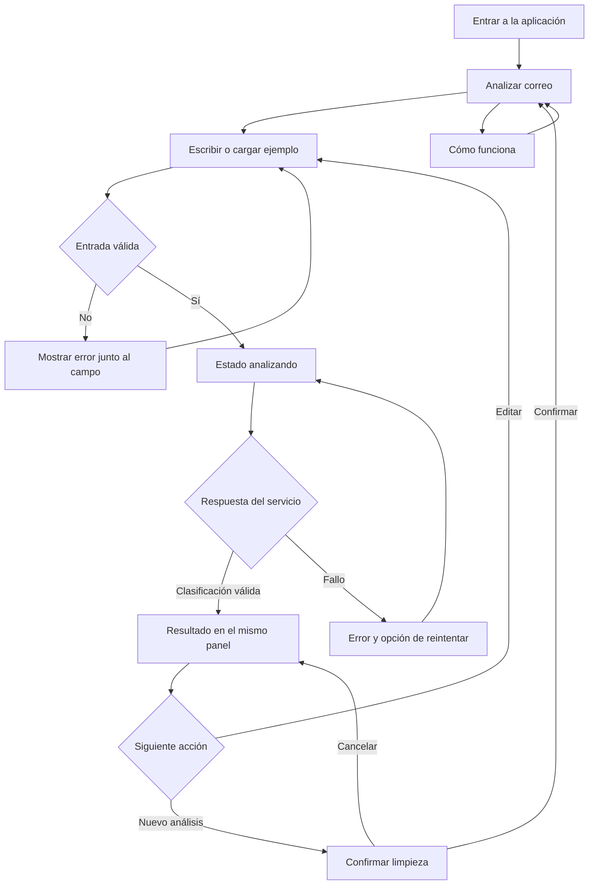

# Primera versión de la interfaz web

Fecha: 29 de septiembre de 2026.  
Rama de trabajo: `feature/web-interface-v1`.  
Estado: propuesta de flujo y pantallas; primera pantalla maquetada en React con datos de demostración.

## Propósito

Crear una interfaz atractiva y fácil de usar para analizar el texto de un correo y consultar su clasificación. El usuario podrá pegar asunto y cuerpo, iniciar el análisis y leer el resultado sin abandonar la pantalla.

La tecnología ya está acordada: **React + TypeScript + Vite + Tailwind CSS + shadcn/ui + React Bits**, con **Flask** como API y el modelo preentrenado ejecutado localmente. La distribución, paleta y navegación de este documento son la propuesta inicial de diseño.

## Cantidad de pantallas y alcance

La primera versión tendrá **dos pantallas navegables**. El resultado, la carga y los errores son estados de la pantalla de análisis, no páginas adicionales.

| Pantalla | Ruta propuesta | Primera versión | Propósito |
| --- | --- | --- | --- |
| Analizar correo | `/` | Sí | Introducir el correo y consultar el resultado. |
| Cómo funciona | `/como-funciona` | Sí | Explicar uso, privacidad y límites del análisis. |
| Bandeja de Gmail | `/bandeja` | Fase posterior | Consultar y analizar correos de una cuenta conectada. |
| Historial | `/historial` | Fase posterior | Revisar análisis guardados. |

Se consideran cuatro pantallas para la evolución del producto, pero solo dos forman parte del primer borrador. Gmail e historial no aparecerán como botones activos hasta contar con esas funciones. No se necesita una pantalla de inicio comercial, un dashboard con estadísticas ni un registro de usuarios para analizar un correo manualmente.

## Alternativas consideradas

| Alternativa | Ventaja | Costo o limitación |
| --- | --- | --- |
| Una sola pantalla con ayuda en un diálogo | Flujo mínimo. | Las explicaciones tienen menos espacio y no se pueden enlazar directamente. |
| Dos pantallas: análisis y ayuda | Mantiene la tarea principal directa y permite explicar el sistema. | Requiere navegación simple. |
| Landing, dashboard, análisis y resultado separado | Más espacio para presentar el proyecto. | Introduce pasos y páginas que todavía no tienen información propia. |

Se propone la segunda alternativa. La entrada abre directamente el analizador y la ayuda queda accesible desde el encabezado.

## Dirección visual

La interfaz se planteará como una herramienta de revisión de correo: clara, contemporánea y con un detalle animado reconocible. El área principal tendrá una composición de editor y resultado, como una mesa de revisión de un mensaje.

- Fondo claro, superficies blancas y encabezado azul profundo.
- Acento azul para navegación y acciones. Verde y rojo se reservan para estados de clasificación, acompañados de texto e iconos.
- Tipografía propuesta: **Manrope**, con una fuente de sistema como respaldo; archivos de fuente servidos desde la aplicación.
- Texto alineado a la izquierda, títulos claros y espacio suficiente para leer correos largos.
- Un efecto de React Bits en la franja del encabezado, inspirado en el recorrido de un mensaje. El formulario y el resultado tendrán fondos sólidos.
- Animación breve al presentar el resultado; sin cursores especiales ni efectos que interfieran con escribir o seleccionar texto.

### Paleta inicial

| Token | Color | Uso |
| --- | --- | --- |
| Fondo | `#F3F6FA` | Área general de trabajo. |
| Superficie | `#FFFFFF` | Formulario y resultado. |
| Texto | `#172B4D` | Títulos y contenido. |
| Texto secundario | `#52627A` | Ayuda y descripciones. |
| Acento | `#2457C5` | Acción principal y selección de navegación. |
| Borde | `#D7DFEB` | Separación de campos y paneles. |

Los colores finales se verificarán en el navegador con texto, estados y foco reales. La selección de un componente concreto de React Bits se hará al maquetar, comprobando su variante TypeScript/Tailwind y sus dependencias.

## Estructura compartida

Encabezado con el nombre **Detector de correos**, navegación **Analizar correo / Cómo funciona** y un fondo visual discreto. El contenido tendrá un ancho máximo aproximado de 1200 px. El pie incluirá la identificación del proyecto académico y un enlace a las limitaciones.

No se mostrará un indicador de “modelo listo” hasta que exista una señal real del backend. La interfaz no necesita exponer nombres de bibliotecas o detalles de infraestructura al usuario para realizar el análisis.

## Pantalla 1: Analizar correo

### Maquetación en escritorio

```text
┌──────────────────────────────────────────────────────────────────────────┐
│ Detector de correos                 Analizar correo    Cómo funciona     │
│                       Franja visual con animación sutil                  │
├──────────────────────────────────────────────────────────────────────────┤
│ Analiza un correo                                                        │
│ Pega el asunto y el contenido para consultar su clasificación.            │
│                                                                          │
│ ┌─────────────────────────────────────┐ ┌──────────────────────────────┐ │
│ │ Contenido del correo                 │ │ Resultado                    │ │
│ │                                     │ │                              │ │
│ │ Asunto (opcional)                    │ │ Antes del análisis:          │ │
│ │ [                                 ] │ │ El resultado aparecerá aquí. │ │
│ │                                     │ │                              │ │
│ │ Cuerpo del correo                   │ │ Después del análisis:        │ │
│ │ [                                 ] │ │ [Clasificación + icono]      │ │
│ │ [                                 ] │ │ Confianza del modelo: … %    │ │
│ │ [                                 ] │ │ Orientación según resultado  │ │
│ │ [                                 ] │ │                              │ │
│ │                                     │ │ [Nuevo análisis]             │ │
│ │ [Cargar ejemplo]     [Limpiar]       │ │                              │ │
│ │ [Analizar correo]                   │ │ Consulta las limitaciones.   │ │
│ └─────────────────────────────────────┘ └──────────────────────────────┘ │
│ El contenido se procesa en el equipo que ejecuta la aplicación.           │
├──────────────────────────────────────────────────────────────────────────┤
│ Proyecto académico                                  Limitaciones         │
└──────────────────────────────────────────────────────────────────────────┘
```

El formulario ocupará aproximadamente el 60 % del espacio y el resultado el 40 %. Ambos paneles compartirán la parte superior. El cuerpo del correo tendrá un campo amplio, redimensionable y con etiqueta visible.

### Campos y acciones

| Elemento | Comportamiento |
| --- | --- |
| Asunto | Opcional. Se conserva tal como lo escribió el usuario. |
| Cuerpo | Obligatorio en el formulario de esta versión; rechaza texto vacío o solo espacios. Es una regla propuesta para la API, aún no implementada. |
| Cargar ejemplo | Selector con dos mensajes ficticios, identificados como ejemplos de demostración. Si reemplaza texto existente, solicita confirmación. |
| Analizar correo | Valida los campos, inicia una petición y deshabilita envíos repetidos mientras espera. |
| Limpiar | Borra formulario y resultado; pide confirmación cuando hay contenido. |
| Nuevo análisis | Aplica la misma confirmación de limpieza y devuelve el foco al asunto. |

No se agregarán remitente, adjuntos o carga de `.eml` en este primer formulario. Los enlaces pegados se tratarán como texto; el contenido del mensaje no se renderizará como HTML.

### Estados del resultado

| Estado | Presentación | Acción disponible |
| --- | --- | --- |
| Inicial | “El resultado aparecerá aquí cuando analices un correo.” | Completar el formulario. |
| Entrada inválida | Mensaje junto al cuerpo: “Pega el contenido del correo para continuar.” | Corregir el campo. |
| Analizando | Indicador indeterminado y “Analizando correo…”. | Esperar; navegación disponible. |
| Legítimo | “Clasificado como legítimo”, icono y confianza. | Revisar el mensaje o iniciar otro análisis. |
| Potencialmente malicioso | “Potencialmente malicioso”, icono y confianza. | Leer la orientación o iniciar otro análisis. |
| Error de servicio | “No pudimos completar el análisis. Tu texto sigue en el formulario.” | Reintentar. |
| Sin conexión | “No se pudo conectar con el servicio de análisis.” | Reintentar cuando esté disponible. |
| Texto editado tras un resultado | “El correo cambió. Analízalo de nuevo para actualizar el resultado.” | Analizar de nuevo. |

Durante la petición se bloqueará la edición del formulario para que el resultado corresponda al contenido visible. Al editar después de una respuesta, la clasificación anterior dejará de mostrarse como resultado vigente. Un error nunca conservará una clasificación anterior como si perteneciera al intento fallido.

La confianza se presentará como **“Confianza del modelo”**, no como “porcentaje de seguridad” ni “probabilidad de que el correo sea seguro”. El código actual devuelve el score de una etiqueta original del modelo, después mapeada a una clase binaria; no es una probabilidad calibrada de la clase binaria.

El texto de orientación será fijo según la clase: para un resultado malicioso, sugerir verificar el remitente por otro medio antes de abrir enlaces o compartir información; para uno legítimo, recordar que la clasificación no garantiza seguridad. No se atribuirán causas concretas al correo.

### Adaptación a celular

```text
┌──────────────────────────────┐
│ Detector de correos          │
│ Analizar | Cómo funciona     │
├──────────────────────────────┤
│ Analiza un correo            │
│ Descripción breve            │
│                              │
│ Asunto (opcional)            │
│ [                          ] │
│ Cuerpo del correo            │
│ [                          ] │
│ [                          ] │
│ [                          ] │
│ [Cargar ejemplo] [Limpiar]    │
│ [      Analizar correo     ] │
│                              │
│ Resultado                    │
│ Clasificación y confianza    │
│ Orientación                  │
│ [      Nuevo análisis      ] │
├──────────────────────────────┤
│ Proyecto académico           │
└──────────────────────────────┘
```

Por debajo de 1024 px, los paneles pasarán a una columna. La navegación seguirá visible y el botón principal ocupará el ancho disponible. Al recibir un resultado en celular, se acercará la vista al panel y se anunciará el cambio de forma accesible, sin animación de desplazamiento cuando se prefiera movimiento reducido.

## Pantalla 2: Cómo funciona

### Maquetación

```text
┌──────────────────────────────────────────────────────────────────────────┐
│ Detector de correos                 Analizar correo    Cómo funciona     │
├──────────────────────────────────────────────────────────────────────────┤
│ Cómo funciona                                                            │
│                                                                          │
│ Pega el correo → Analiza su texto → Consulta la clasificación              │
│                                                                          │
│ Qué información se analiza                                                │
│ El asunto y el cuerpo que introduces en el formulario.                    │
│                                                                          │
│ Qué significa el resultado                                                │
│ Legítimo / Potencialmente malicioso / Confianza del modelo.                │
│                                                                          │
│ Privacidad y límites                                                      │
│ Procesamiento local, conservación del texto y límites del clasificador.   │
│                                                                          │
│ [Analizar un correo]                                                      │
├──────────────────────────────────────────────────────────────────────────┤
│ Proyecto académico                                                       │
└──────────────────────────────────────────────────────────────────────────┘
```

Será una página de lectura de una columna, de ancho aproximado de 760 px, con secciones breves y preguntas frecuentes desplegables cuando aporten claridad.

Contenido requerido:

- Cómo copiar y pegar asunto y cuerpo.
- Qué significa cada clasificación y qué significa la confianza.
- Que el resultado es una ayuda para revisar mensajes y puede equivocarse.
- Que no se inspeccionan adjuntos ni se verifica la reputación de enlaces.
- Que el modelo procesa como máximo 512 tokens y puede recortar correos largos; no confundir tokens con caracteres.
- Que el análisis se ejecuta en el equipo que aloja Flask y el modelo. Si se abre desde otro dispositivo, el texto viaja a ese equipo.
- Que el diseño de v1 no contempla guardar el cuerpo ni el resultado de forma persistente; esto deberá verificarse también en el backend y sus registros.
- Que Gmail todavía no está conectado.

No se publicará la evaluación de 100 correos como una garantía de precisión para cualquier mensaje.

## Flujo de navegación y análisis



Navegar a la ayuda y volver conservará el borrador y el resultado durante la sesión de la aplicación. Se mantendrán en memoria de React, sin guardarlos en almacenamiento persistente del navegador. Recargar la página reiniciará el formulario; no se ofrecerán enlaces compartibles a resultados en v1.

## Pantallas previstas para una fase posterior

### Bandeja de Gmail

```text
Encabezado y navegación
Cuenta conectada / Conectar Gmail
Filtros de mensajes + Actualizar + Analizar selección
Lista de correos              | Detalle del correo seleccionado
Estado de análisis por mensaje| Clasificación y confianza
```

Flujo previsto: conectar cuenta → autorizar con Google → cargar mensajes → seleccionar → analizar → consultar resultado. Los estados desconectado, sin mensajes, autorización cancelada y fallo de sincronización deberán diseñarse al iniciar esa fase. La lectura automática será una evolución independiente.

### Historial

```text
Encabezado y navegación
Historial de análisis
Filtros por clasificación y fecha
Tabla: fecha / asunto / origen / clasificación / confianza
Detalle de un registro seleccionado
Estado vacío: todavía no hay análisis guardados
```

Requerirá decidir qué se almacena, durante cuánto tiempo y cómo se elimina. No se asumirá el guardado del cuerpo completo. Estas decisiones y SQLite quedan fuera del primer borrador.

## Componentes y organización previstos

| Componente | Responsabilidad | Base visual |
| --- | --- | --- |
| `AppShell` | Encabezado, navegación, contenido y pie. | Tailwind y navegación accesible. |
| `EmailAnalysisPage` | Coordinar formulario y estados del análisis. | Composición propia. |
| `EmailForm` | Campos, validación y acciones. | shadcn/ui: Input, Label, Textarea, Button. |
| `ExamplePicker` | Elegir un mensaje ficticio. | shadcn/ui: Dialog y Button. |
| `AnalysisResult` | Clasificación, confianza y orientación. | shadcn/ui: Badge, Alert y Button. |
| `ClearConfirmation` | Confirmar que se borra el contenido. | shadcn/ui: AlertDialog. |
| `HowItWorksPage` | Ayuda, privacidad y limitaciones. | Texto y Accordion de shadcn/ui. |
| `HeaderVisual` | Efecto decorativo aislado del flujo. | Componente gratuito de React Bits. |
| Servicio de análisis | Petición a Flask y traducción de errores. | TypeScript; sin dependencias visuales. |

Se propone alojar el frontend en `frontend/`, separado de `src/`, que contiene la lógica Python. La estructura concreta y el mecanismo de rutas se definirán en el plan de implementación. No se añadirán bibliotecas de estado global para este flujo pequeño.

## Conexión con el backend

La API todavía no está implementada. Este es el contrato propuesto para la integración:

```http
POST /api/analyze
Content-Type: application/json
```

```json
{
  "subject": "Reunión de equipo",
  "body": "Hola, confirmamos la reunión de mañana."
}
```

Respuesta propuesta:

```json
{
  "label": "legitimate",
  "confidence": 0.93
}
```

Los valores anteriores son ilustrativos, no una predicción real. Las clases válidas serán `legitimate` y `malicious`; la confianza será un número entre 0 y 1. Un error tendrá un mensaje legible y un código estable; el frontend rechazará respuestas incompletas o con valores fuera del contrato.

Flask validará la entrada y reutilizará una instancia del clasificador en lugar de cargar el modelo en cada petición. No se entrenará desde la web. La interfaz no anunciará disponibilidad ni progreso porcentual de inferencia si el servicio no los informa.

## Maquetación antes de integrar la IA

El siguiente paso de implementación será construir las dos pantallas con datos de demostración y todos los estados del analizador. Cada resultado simulado tendrá una marca visible **“Demostración”**, y el entorno mostrará **“Vista de demostración: el modelo todavía no está conectado”**.

El servicio de demostración y el servicio HTTP compartirán la misma forma de respuesta. Al conectar Flask se sustituirá el origen de los datos y se quitará la marca de demostración solo cuando exista una respuesta real. Si la API falla, no se devolverá una clasificación ficticia como respaldo.

## Criterios para revisar el primer borrador

- Las dos pantallas se pueden abrir, navegar y volver sin perder el borrador durante la sesión.
- La pantalla inicial explica qué hacer y no muestra cifras ficticias de actividad.
- Se pueden demostrar los estados inicial, analizando, legítimo, malicioso, entrada inválida y error.
- Editar el correo invalida la clasificación visible anterior.
- Reintentar conserva el texto; limpiar confirma antes de borrarlo.
- El formulario funciona con teclado, etiquetas visibles y foco claro; los resultados y errores se anuncian de forma accesible.
- La pantalla se adapta a anchos de 360, 768 y 1440 px sin desplazamiento horizontal.
- React Bits respeta movimiento reducido y tiene una alternativa estática si el efecto no puede ejecutarse.
- La confianza, los mensajes de orientación y los ejemplos no presentan conclusiones que el clasificador no entrega.
- Se inspeccionan capturas de escritorio y celular antes de dar por terminada la maquetación.

## Secuencia de trabajo

1. Revisar esta propuesta de pantallas, flujo y dirección visual.
2. Preparar un plan de implementación sobre la rama actual.
3. Crear el frontend con el stack acordado.
4. Maquetar estructura compartida y pantalla de análisis.
5. Implementar estados con datos de demostración identificados.
6. Maquetar Cómo funciona y adaptar ambas pantallas a celular.
7. Revisar visualmente el borrador y ajustar distribución, tipografía y movimiento.
8. Integrar la API Flask y comprobar el flujo con respuestas reales.

## Referencias del proyecto

- [Stack acordado y estado actual](../README.md#tecnologías-definidas).
- [Modelo preentrenado y módulos existentes](modelo-preentrenado.md).
- `src/email_data.py`: entrada interna con asunto y cuerpo.
- `src/hf_classifier.py`: etiquetas, score y límite de 512 tokens.

## Avance implementado — primera pantalla

La pantalla Analizar correo está maquetada en `frontend/`. Incluye formulario, estados inicial/carga/resultado/error, dos ejemplos ficticios, confirmación de limpieza o reemplazo y ayuda en un diálogo. React Bits aporta la transición del resultado mediante FadeContent; el encabezado usa una ilustración estática para conservar la lectura.

La ayuda en diálogo sustituye temporalmente la ruta independiente Cómo funciona, que queda para el siguiente avance. No hay enlaces activos a pantallas todavía inexistentes. El texto libre informa que falta integrar el modelo; únicamente los ejemplos exactos devuelven resultados simulados.

La compilación y el lint pasaron, junto con las 12 pruebas Python existentes. Se revisó la pantalla en navegador a 360, 768 y 1440 px sin desplazamiento horizontal, además de las interacciones de carga, validación, edición, limpieza y ayuda. La API Flask y las pantallas posteriores siguen pendientes. Las instrucciones están en [frontend/README.md](../frontend/README.md).
